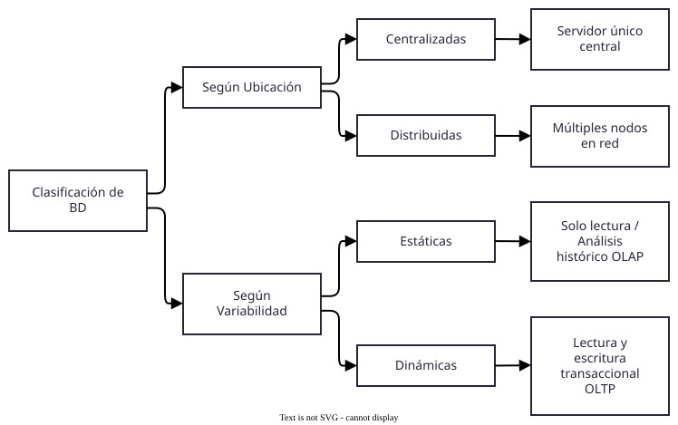

[⬅️ Volver al README Principal](../README.md) 
# Tarea 1.2: Clasificación y Arquitecturas (ANSI/SPARC y SGBD) 
**Asignatura:** Fundamentos de Bases de Datos 

**Unidad 1:** Introducción a las bases de datos 

**Estudiante:** Marcos Daniel Loera Sanchez 

**Profesor:** [Nombre del Docente] 

--- 

## 1. Introducción Este documento detalla la clasificación de las bases de datos según criterios de ubicación y variabilidad, la arquitectura de tres niveles ANSI/SPARC y la arquitectura funcional interna del SGBD [3]. 

---

## 2. Clasificación de las Bases de Datos 

### 2.1. Cuadro Sinóptico de Clasificación 

 

* ✏️ **Fuente editable en código:** [`cuadro_sinoptico.drawio`](./diagramas/cuadro_sinoptico.drawio)

### 2.2. Descripción de las Clasificaciones 
1. **Según la Ubicación de los Datos:**
* **Centralizadas:** Los datos residen y se procesan en un único equipo o servidor central.
* **Distribuidas:** Los datos se almacenan en múltiples nodos independientes interconectados a través de una red.
2. **Según la Variabilidad de los Datos:**
* **Estáticas:** Diseñadas para lectura y análisis de información histórica (ej. Data Warehouses / OLAP).
* **Dinámicas:** Permiten operaciones continuas de consulta, inserción, actualización y borrado en tiempo real (ej. OLTP).

---

## 3. Arquitectura de Tres Niveles (ANSI/SPARC) La arquitectura ANSI/SPARC establece tres niveles de abstracción para garantizar la independencia entre los programas de aplicación y los datos físicos almacenados [3]: 

 

*✏️ **Fuente editable en código:** [`arquitectura_ansi_sparc.drawio`](./arquitectura\_ansi\_sparc.drawio) 

### 3.1. Niveles de Abstracción y Flujo de Datos 
* **Nivel Físico (Interno):** Describe las estructuras de almacenamiento primario, índices y organización de archivos en disco. * **Nivel Conceptual:** Representa la estructura lógica global de la base de datos (entidades, atributos, relaciones y restricciones de integridad).
* **Nivel Externo (Vistas):** Muestra las vistas parciales personalizadas para los diferentes usuarios o aplicaciones.
* **Flujo de Datos e Independencia:** El SGBD mapea las consultas desde las vistas externas hacia el nivel conceptual y posteriormente al nivel físico, permitiendo la **independencia física** (modificar el almacenamiento sin alterar el nivel conceptual) e **independencia lógica** (alterar el esquema conceptual sin romper las aplicaciones externas).

--- 

## 4. Arquitectura Funcional del SGBD y sus Módulos El SGBD está constituido por componentes funcionales que procesan las peticiones SQL y coordinan el acceso al almacenamiento [3, 5]: 

 

✏️ **Fuente editable en código:** [`arquitectura_sgbd.drawio`](./arquitectura_sgbd.drawio) 

### 4.1\. Módulos Internos 
* **Procesador de Consultas:\*\* Parsea, compila y traduce las sentencias SQL expresadas por los usuarios.
* **Optimizador de Consultas:** Determina el plan de ejecución de menor costo computacional.
* **Gestor de Almacenamiento (Storage Manager):** Proporciona la interfaz entre los datos de bajo nivel almacenados en disco y las aplicaciones.
* **Gestor de Transacciones y Concurrencia:** Garantiza el cumplimiento de las propiedades ACID y resuelve bloqueos en accesos simultáneos.
---

## 5. Enlaces de Entregables 
* 🎥 **Video Explicativo en YouTube:** [Ver exposición en YouTube]([suspicious link removed]) *(Reemplazar con tu enlace público)
* 📂 **Repositorio de GitHub:** [Ver archivos fuente](https://github.com) *(Reemplazar con tu enlace)*
---

## 6. Referencias Bibliográficas (Formato APA) 
* Date, C. J. (2004). *An Introduction to Database Systems* (8th ed.). Addison-Wesley.
* Elmasri, R., &amp; Navathe, S. B. (2017). *Fundamentals of Database Systems\* (7th ed.). Pearson.
* Silberschatz, A., Korth, H. F., &amp; Sudarshan, S. (2020). *Database System Concepts* (7th ed.). McGraw-Hill.
