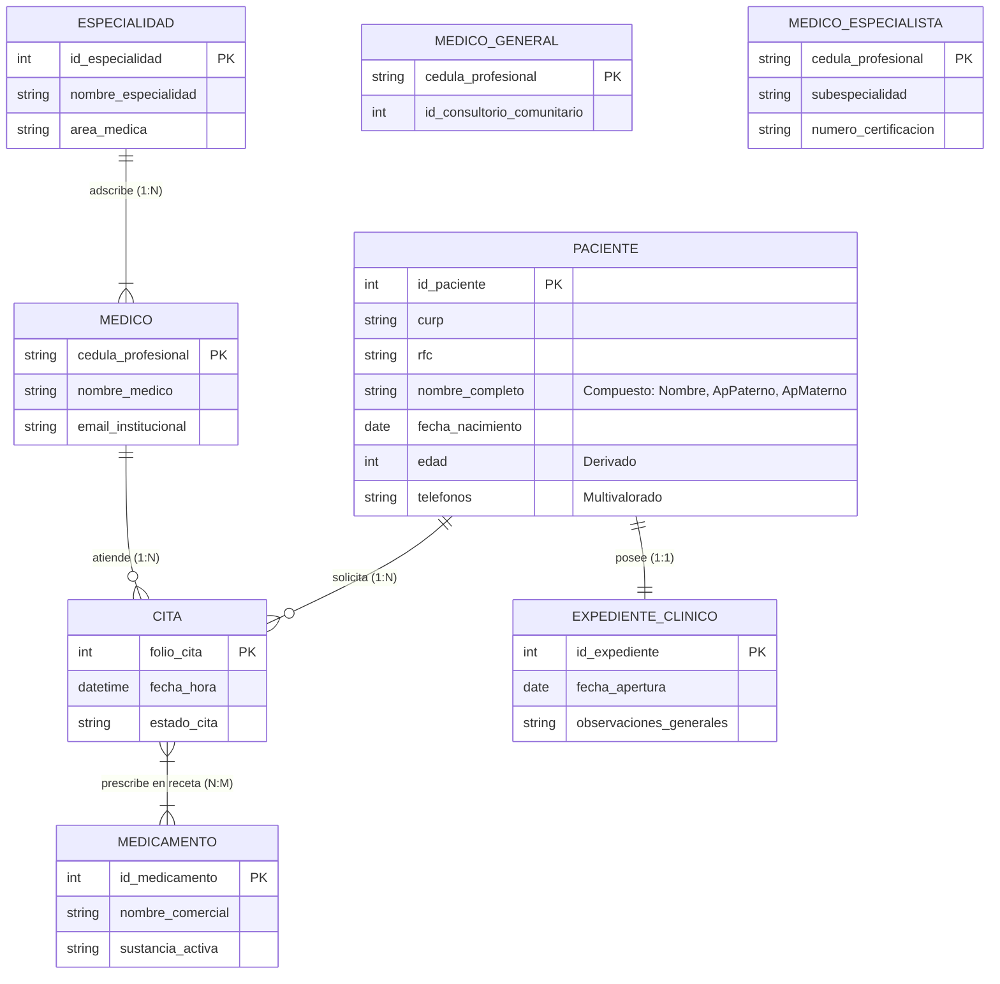

[⬅️ Volver al README anterior](../README.md) 
# Tarea 2.1: Modelado Conceptual E-R y E-R Extendido de un Caso Real

**Asignatura:** Fundamentos y Arquitectura de Bases de Datos  
**Unidad 2:** Diseño de Bases de Datos con el modelo E-R  
**Estudiante:** Marcos Daniel Loera Sanchez  
**Profesor:** [Nombre del Docente]  
**Fecha:** 30 de Octubre de 2026  

---

## 1. Planteamiento del Caso de Estudio Real

Se presenta el diseño conceptual para el **Sistema de Gestión de una Clínica Médica Sanitaria**. El sistema controla el registro de pacientes, asignación de médicos según especialidad, programación de citas, expedientes clínicos y emisión de recetas con medicamentos.

---

## 2. Reglas de Negocio Institucionales

1. **RN-01 (Pacientes):** Un paciente se identifica con `id_paciente` (PK) e incluye CURP, RFC, Nombre Completo (atributo compuesto: *nombre*, *apellido_paterno*, *apellido_materno*), Fecha de Nacimiento y Teléfonos (atributo multivalorado). La *edad* es un atributo derivado.
2. **RN-02 (Médicos y Especialidades):** Cada Médico posee una Cédula Profesional (PK) y pertenece a una Especialidad Médica (1:N). Un médico atiende múltiples Citas.
3. **RN-03 (Gestión de Citas):** Un Paciente agendará una o más Citas (1:N) con un Médico en fecha y hora específicas.
4. **RN-04 (Expedientes y Recetas):** Toda Cita genera un Diagnóstico en el Expediente Clínico del Paciente (1:1) y puede derivar en una Receta con uno o más Medicamentos (N:M).
5. **RN-05 (E-R Extendido):** Los Médicos se especializan en **Médico General** o **Médico Especialista** (Jerarquía Disjunta y Total).

---

## 3. Diagrama Entidad-Relación y E-R Extendido (Mermaid)

## 5\. Enlaces de Entregables

* 🎥 **Video Explicativo en YouTube:** [Ver Exposición en YouTube]([suspicious link removed]) *(Reemplazar con tu enlace con cámara activa)*
* 📂 **Repositorio Público de GitHub:** [Ver archivos en GitHub](https://www.google.com/url?sa=E&amp;q=https%3A%2F%2Fgithub.com) *(Reemplazar con tu enlace)*

---

## 6\. Referencias Bibliográficas (APA 7ª ed.)

* Date, C. J. (2004). *An Introduction to Database Systems* (8th ed.). Addison-Wesley.
* Elmasri, R., &amp; Navathe, S. B. (2017). *Fundamentals of Database Systems* (7th ed.). Pearson.
* Silberschatz, A., Korth, H. F., &amp; Sudarshan, S. (2020). *Database System Concepts* (7th ed.). McGraw-Hill.
