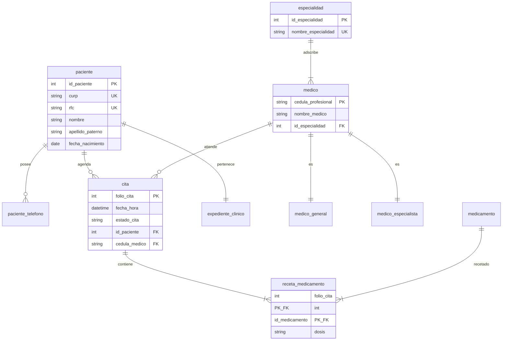

# Tarea 3.1: Transformación de Modelo E-R a Esquema Relacional y Reglas de Integridad

**Asignatura:** Fundamentos y Arquitectura de Bases de Datos  
**Unidad 3:** Modelo Relacional  
**Estudiante:** Marcos Daniel Loera Sanchez  
**Matrícula:** I24050383  
**Periodo:** 2026-2  
**Fecha:** 31 de Octubre de 2026  

---

## 1. Introducción y Fundamentos del Modelo Relacional

El Modelo Relacional formaliza la estructura de datos mediante tablas (relaciones), filas (tuplas) y columnas (atributos), fundamentado en la teoría de conjuntos y la lógica de predicados. Su fortaleza reside en la aplicación estricta de las restricciones de integridad, asegurando que la base de datos se mantenga libre de anomalías durante las operaciones de inserción, actualización y borrado.

---

## 2. Componentes Formales y Restricciones de Integridad
* **Tabla Componentes Formales y Restricciones de Integridad** [`Tabla_Componentes_F_y_RI`](./Tablas/Tablas.md)

---

## 3. Reglas de Transformación Aplicadas (E-R a Relacional)

1. **Mapeo de Entidades Fuertes:** Se convierten en tablas independientes. Los atributos compuestos se dividen en columnas simples (`nombre_completo` $\rightarrow$ `nombre`, `apellido_paterno`, `apellido_materno`).
2. **Mapeo de Atributos Multivalorados:** Se genera una tabla secundaria (`paciente_telefono`) con la PK de la entidad y el atributo multivalorado formando una PK compuesta.
3. **Relaciones 1:1 (Entidad Débil):** La PK de la entidad fuerte (`PACIENTE`) se propaga como FK a la entidad débil (`EXPEDIENTE_CLINICO`) añadiendo la restricción `UNIQUE`.
4. **Relaciones 1:N:** La PK del lado '1' (`ESPECIALIDAD`) se propaga como FK a la tabla del lado 'N' (`MEDICO`).
5. **Relaciones N:M:** Se crea una tabla intermedia (`receta_medicamento`) con las FKs de ambas entidades asociadas formando una PK compuesta.
6. **Jerarquías E-RE (Especialización):** Mapeo por Subclase, donde `medico_general` y `medico_especialista` poseen su propia PK que actúa simultáneamente como FK hacia `medico`.

---

## 4. Esquema Relacional Tabular en Mermaid

---

## 5\. Enlaces de Entregables Digitales

* 🎥 **Video Explicativo en YouTube:** [Ver Exposición en YouTube]([suspicious link removed]) *(Con cámara web visible en la esquina inferior derecha)*
* 📂 **Repositorio Público de GitHub:** [Ver archivos en GitHub](https://www.google.com/url?sa=E&amp;q=https%3A%2F%2Fgithub.com)
* 📄 **Reporte Formal en PDF:** [Reporte\_Tarea\_3\_1.pdf](./Reporte%5FTarea%5F3%5F1.pdf)

---

## 6\. Referencias Bibliográficas (APA 7.ª ed.)

* Date, C. J. (2004). *An Introduction to Database Systems* (8th ed.). Addison-Wesley.
* Elmasri, R., &amp; Navathe, S. B. (2017). *Fundamentals of Database Systems* (7th ed.). Pearson.
* Silberschatz, A., Korth, H. F., &amp; Sudarshan, S. (2020). *Database System Concepts* (7th ed.). McGraw-Hill.
