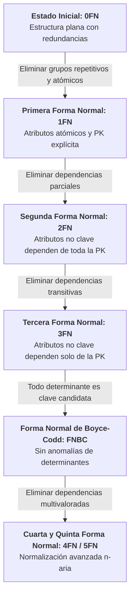

# Tarea 4.1: Fundamentos de Dependencias Funcionales y Mapa Conceptual de Formas Normales

**Asignatura:** Fundamentos de Bases de Datos  
**Unidad 4:** Normalización de Bases de Datos  
**Estudiante:** Marcos Daniel Loera Sanchez  
**Matrícula:** I24050383  
**Periodo:** 2026-2  
**Fecha:** 31 de Octubre de 2026  

---

## 1. Introducción al Proceso de Normalización y Control de Anomalías

La normalización de bases de datos es un proceso formal de diseño relacional destinado a descomponer esquemas con redundancia excesiva. Su propósito central es eliminar anomalías durante las operaciones de modificación de datos y garantizar la integridad referencial.

### Anomalías Clásicas en Esquemas No Normalizados:
1. **Anomalía de Inserción:** Ocurre cuando no es posible registrar información sobre una entidad sin forzar la inserción de datos no relacionados o inexistentes de otra entidad.
2. **Anomalía de Borrado:** Sucede cuando la eliminación de un registro provoca la pérdida no deseada e irreversible de información valiosa de una entidad secundaria.
3. **Anomalía de Modificación (Actualización):** Ocurre cuando un dato duplicado se modifica en una fila pero no en las demás tuplas repetidas, generando inconsistencias de datos.

---

## 2. Clasificación Formal de Dependencias Funcionales

La teoría de dependencias funcionales (DF) establece la relación matemática entre atributos ----> determina funcionalmente X a Y:

| Tipo de Dependencia | Definición Técnica | Aplicación en el Sistema Clínico |
| :--- | :--- | :--- |
| **Dependencia Total / Completa** | \\(Y\\) depende funcionalmente de la clave primaria compuesta \\(X\\) en su totalidad, y no de ningún subconjunto propio de esta. | En `receta_medicamento`: `(folio_cita, id_medicamento)` \\(\rightarrow\\) `dosis`. |
| **Dependencia Parcial** | \\(Y\\) depende de un subconjunto propio de una clave primaria compuesta \\(X\\). | En tabla plana: `(folio_cita, id_medicamento)` \\(\rightarrow\\) `sustancia_activa` (solo depende de `id_medicamento`). |
| **Dependencia Transitiva** | \\(X \rightarrow Y\\) y \\(Y \rightarrow Z\\), donde \\(Z\\) depende de \\(X\\) indirectamente a través del atributo no clave \\(Y\\). | `cedula_medico` \\(\rightarrow\\) `id_especialidad` \\(\rightarrow\\) `nombre_especialidad`. |

---

## 3. Mapa Conceptual de Formas Normales (Mermaid)

4. Reglas Formales para la Normalización
| Forma Normal | Condición Exigida | Estrategia de Descomposición Aplicada |
| :--- | :--- | :--- |
| **1FN** | Atributos atómicos; sin grupos repetitivos ni arreglos. | Separar atributos multivalorados en tablas independientes con PK compuesta. |
| **2FN** | Estar en 1FN y sin dependencias parciales respecto a la PK compuesta. | Extraer los atributos que dependen de parte de la llave hacia una nueva tabla. |
| **3FN** | Estar en 2FN y sin dependencias transitivas entre atributos no clave. | Mover los determinantes intermedios $Y \rightarrow Z$ a su propia entidad relacional. |
| **FNBC** | Estar en 3FN y todo determinante $X \rightarrow Y$ debe ser una clave candidata. | Descomponer relaciones donde atributos no primarios determinen componentes de claves. |
5. Enlaces de Entregables Digitales
* **📂 Repositorio Público de GitHub:** Ver repositorio en GitHub
* **📄 Reporte Formal en PDF:** Reporte_Tarea_4_1.pdf6.

* **Referencias Bibliográficas**
* Date, C. J. (2004). An Introduction to Database Systems (8th ed.). Addison-Wesley.
* Elmasri, R., & Navathe, S. B. (2017). Fundamentals of Database Systems (7th ed.). Pearson.
* Silberschatz, A., Korth, H. F., & Sudarshan, S. (2020). Database System Concepts (7th ed.). McGraw-Hill.
